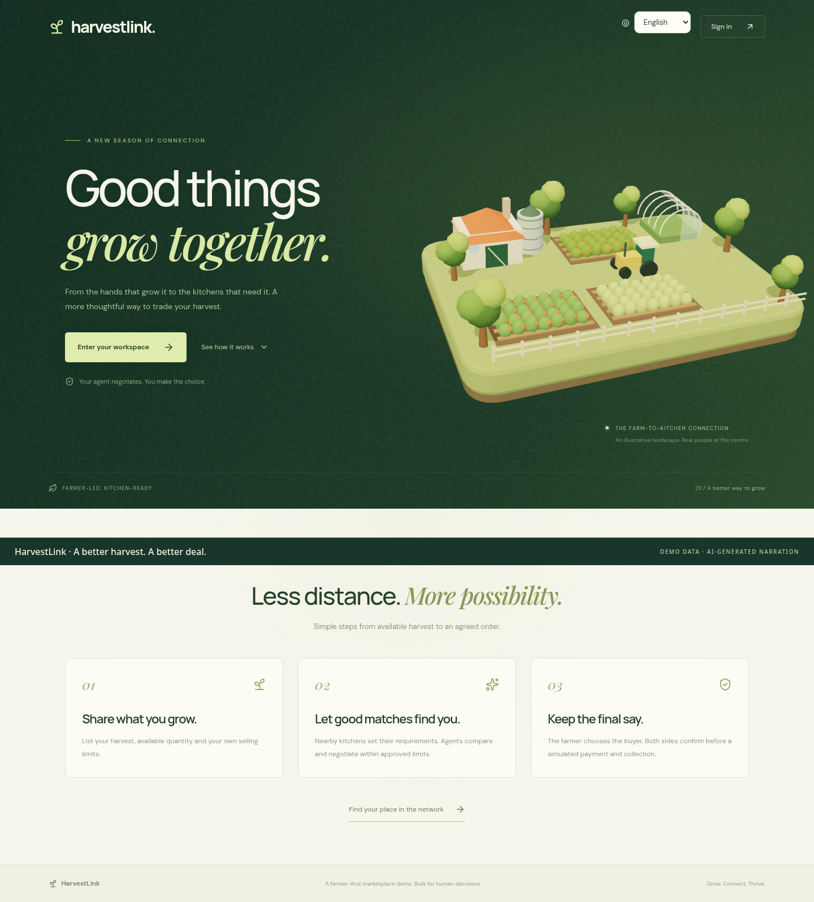
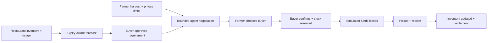
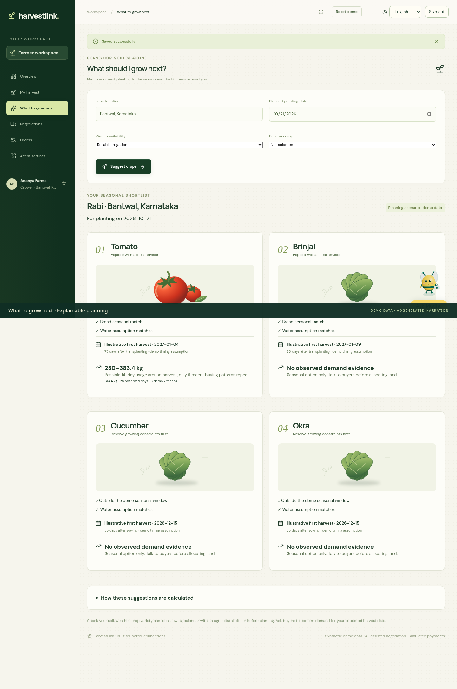
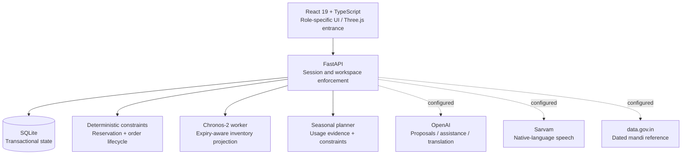

<div align="center">

# harvestlink.

### A better harvest. A better deal.

**From a kitchen’s next shortage to a farmer’s next confirmed sale.**


[**Watch the 3:50 demo →**](docs/video/harvestlink-demo.mp4) · [Run it locally](#run-it-locally) · [Verification](docs/VERIFICATION.md) · [CSV samples](demo-data/README.md)

</div>



**DevHack · PS 1.2 — Direct Market-Access Platform for Marginal Farmers**

A farmer has produce ready today. A restaurant will run short tomorrow. Between them are unanswered questions: *Who needs this crop? What terms work for both sides? Will the stock arrive before it is needed? Who makes the final decision?*

HarvestLink connects those decisions in one working prototype. Restaurants forecast consumption and approve requirements. Farmers list harvests, compare bounded agent offers, and choose a buyer. Both parties confirm before a traceable, simulated payment and delivery workflow begins.

> **Agents negotiate. People agree. The farmer keeps the final choice.**

## The project in 60 seconds

| Question | What the demo demonstrates |
| --- | --- |
| Who is it for? | One marginal-farmer scenario and three independent restaurant buyers |
| Why would a farmer join? | Reach buyers, compare terms, use native-language help, retain sale approval |
| Why would a restaurant join? | See projected shortages, account for expiry, and purchase against explicit requirements |
| What is the technical contribution? | Forecast-to-requirement-to-negotiation-to-reservation-to-inventory, with server-enforced constraints |
| Where does AI help? | Chronos-2 consumption forecasts, optional OpenAI proposals, multilingual assistance and Sarvam speech |
| What is verified? | 22 backend tests, 13 browser tests, actual Chronos inference, live OpenAI and Sarvam calls |
| What remains a simulation? | Participants, histories, default market references, collection distances and all payments |

This is a hackathon prototype. It does **not** claim field validation, guaranteed better prices, or production financial infrastructure.

## Follow one complete trade



### 1. A farmer workspace that starts with the harvest


List crop, variety, declared grade, kilograms, asking price and dates. Upload a CSV when there is more to enter. Imports validate every row before saving; malformed data does not partially overwrite the workspace.

The farmer and buyer choose their role at login and receive separate interfaces. English and ten Indian languages are available: Hindi, Kannada, Tamil, Telugu, Malayalam, Marathi, Gujarati, Bengali, Punjabi and Odia. Madhu, the honeybee assistant, replies in the selected language and uses **Sarvam Bulbul v3** for speech. Translation catalogs still need native-speaker review.

The original Three.js farm rotates slowly, responds to dragging and keyboard arrows, and respects reduced-motion preferences. The workspaces prioritize ordinary forms and clear actions.

### 2. Kitchen forecasts that lead to a purchase decision


**Chronos-2 predicts consumption; deterministic inventory logic calculates replenishment.**

The seeded demo provides 90 days of synthetic usage for each restaurant. A seven-day forecast is combined with batch expiry, funded incoming stock, a planning lead time and a replenishment window. Consumption and waste remain separate. Stockout-censored observations are not silently treated as zero demand.

The restaurant reviews the suggestion and approves a requirement. A forecast never silently places an order.

**Measured result, not a performance claim:** on one seeded held-out week, Chronos MAE was **0.598 kg**, compared with **0.469 kg** for a weekday seasonal-naive baseline. The baseline performed better. This comparison remains visible; synthetic data cannot establish operational accuracy. Forecasting currently demonstrates **Tomato**, while listings and inventory support additional crops.

### 3. Three buyers, bounded proposals, one human choice


Each participant sets private limits. The farmer defines a price floor, minimum order size and radius. Each restaurant defines a price ceiling, quantity, total budget and radius.

The server validates generated proposals against those constraints. Offers expose price, quantity, collection responsibility, illustrative distance and negotiation steps. A buyer’s private budget is not sent to another participant’s agent. The system can return **no acceptable deal**.

The farmer explicitly chooses an offer. The restaurant then confirms. Confirmation rechecks current limits and inventory, and reserves stock atomically. Policy changes invalidate outstanding proposals; expired unfunded reservations release stock.

### 4. A visible agreement and payment lifecycle


`Awaiting buyer → Reserved → Funded → Picked up → Received → Settled`

Every transition is an explicit participant action. Receipt adds an inventory batch for the buyer. Tests cover repeated commands, concurrent reservations, cancellation, refunds and expiry behavior.

**All escrow balances and transfers are simulated.** No real money, regulated escrow account, payment gateway or carrier movement is represented as connected.

### 5. Planning beyond today’s sale



The farmer’s **What to grow next** view combines broad seasonal suitability, water availability, previous crop family and recent aggregate kitchen usage. It shows illustrative harvest timing, demand evidence, no-data states and growing constraints.

Demand ranges are scenarios derived from recent usage—not purchase commitments, confidence intervals or validated seasonal forecasts. Location is captured for context; the prototype does not claim soil testing, hyperlocal climate modeling or agronomist approval. Method assumptions and agricultural references are available inside the view.

## What is real, what is simulated

| Capability | Implementation and boundary |
| --- | --- |
| Identity | Server-validated demo accounts, hashed password verification, HttpOnly cookies, role enforcement; no public registration or production identity service |
| Negotiation | Reproducible local policy engine by default; optional credentialed OpenAI structured proposals; hard server-side validation in both modes |
| Forecasting | Actual pretrained Chronos-2 inference on CPU; no fine-tuning; explicit baseline/failure status |
| Voice help | OpenAI text assistance and Sarvam speech when configured; server-side credentials |
| Mandi reference | Optional data.gov.in adapter; source and reporting date shown; no government key means labelled synthetic reference |
| Nearby buyers | Seeded collection distances for comparison; **no live GPS, road routing or delivery integration** |
| Crop planning | Explainable seasonal and demand scenarios, with assumptions and cautions |
| Escrow | State-machine simulation only; no real funds |

Direct purchasing may improve terms, but removing an intermediary does not remove transport, grading, spoilage or coordination costs. HarvestLink makes these decisions inspectable; it does not guarantee savings.

## Architecture you can inspect



| Code | Responsibility |
| --- | --- |
| [`backend/app.py`](backend/app.py) | API, participant commands and atomic persistence |
| [`backend/identity.py`](backend/identity.py) | Sessions, demo identities and access enforcement |
| [`backend/domain.py`](backend/domain.py) | Trading domain, seeded data and inventory projection |
| [`backend/planning.py`](backend/planning.py) | Seasonal crop ranking and transparent demand scenarios |
| [`backend/assistance.py`](backend/assistance.py) | Language assistance and Sarvam speech |
| [`frontend/src/App.tsx`](frontend/src/App.tsx) | Farmer and restaurant workflows |
| [`frontend/src/Welcome.tsx`](frontend/src/Welcome.tsx) | Landing, role selection and onboarding |
| [`frontend/src/CropPlanner.tsx`](frontend/src/CropPlanner.tsx) | Farmer crop-planning interface |
| [`backend/tests`](backend/tests) / [`frontend/e2e`](frontend/e2e) | Domain, API and browser verification |

## Run it locally

Requires **Python 3.12–3.13**, **uv**, and **Node.js 20+**. Chronos downloads model weights on first use and needs additional disk space; CPU inference is supported.

```bash
git clone git@github.com:Preethesh16/HarvestLink.git
cd HarvestLink
cp .env.example .env
make setup
make dev
```

Open **http://127.0.0.1:5173**. Select **Farmer** or **Buyer**, sign in, then complete the profile. Repository access is required while the project is private.

| Role | Username | Workspace |
| --- | --- | --- |
| Farmer | `farmer` | Ananya Farms |
| Buyer | `restaurant1` | The Green Table |
| Buyer | `restaurant2` | Coastal Kitchen |
| Buyer | `restaurant3` | Roots & Grains |

All four **public demo accounts** use `Harvest@123`. They are sample identities, not credentials suitable for a public production deployment.

### Optional integrations

Edit the ignored server-side `.env`:

```dotenv
NEGOTIATION_MODE=local
FORECAST_MODE=chronos
# Enable live proposals with NEGOTIATION_MODE=openai
OPENAI_MODEL=gpt-4.1-mini
OPENAI_API_KEY=
SARVAM_API_KEY=
DATA_GOV_API_KEY=
```

Never put provider keys in frontend variables or commit them. OpenAI and Sarvam calls require valid credentials and incur provider usage. No key is needed for local policy negotiation. Government reference refresh must be treated as dated reporting, not a continuous exchange price.

### Bring your own CSV

[Download and understand the sample files →](demo-data/README.md)

- **Harvest:** crop, variety, grade, quantity, unit, asking price, harvest and availability dates.
- **Inventory:** crop, kilograms and usable-until date for each batch.
- **Consumption:** date, crop, quantity, waste and stockout flag.

Use the in-app templates for current dates. Inventory imports append batches unless the restaurant explicitly selects replacement. Consumption imports reject duplicate crop/date pairs. Run `make demo-data` to regenerate the supplied synthetic examples relative to today.

## Verification and reproducibility

| Check | Recorded result |
| --- | --- |
| Backend suite | **22 passed** |
| Browser suite | **13 passed** |
| TypeScript / production build | Passed; Three.js chunk-size advisory remains |
| Ruff / Python compile | Passed |
| Independent UI audit | **8.4/10** engineering review; not a farmer field trial |
| Live services | OpenAI negotiation, Chronos inference and Kannada Sarvam audio exercised |

```bash
make test
cd frontend
npx playwright install chromium
npx playwright test
```

Browser tests mutate demo data. Use an isolated backend/database and frontend proxy for verification; the executed audit used ports **8001 / 5174** with `HARVESTLINK_DB=var/visual-tests.sqlite3`. See [the verification record](docs/VERIFICATION.md) for coverage and limits. Passing tests demonstrate covered paths, not defect-free software.

The [living plan](plan.md) records milestones and fixes. The [demo production notes](docs/DEMO.md) include timestamps, narration provenance and recording instructions.

## Next validation steps

1. Interview farmers and restaurant purchasing staff; measure time to agreement, rejection reasons and repeat use.
2. Test forecasts on consented real usage data, against simple baselines and explicit waste/stockout costs.
3. Validate local crop calendars with agricultural experts and add buyer commitments distinct from demand scenarios.
4. Connect verified grading, real routes and a suitable payment partner before any production trade.
5. Review regional translations with native speakers and observe first-time users on low-end devices.

## Design provenance

HarvestLink is a fresh implementation. The user’s **Inception** project informed forecasting presentation and supplied the original mascot geometry adapted into Madhu; **Parcelwise** informed the delivery workflow direction. The agricultural scene and produce artwork are original procedural/SVG assets. Demo narration is explicitly AI-generated; the screen recording shows the working prototype with synthetic participants.

<div align="center">

**A farmer’s harvest deserves a clear path to a buyer—and a decision that stays theirs.**

</div>
