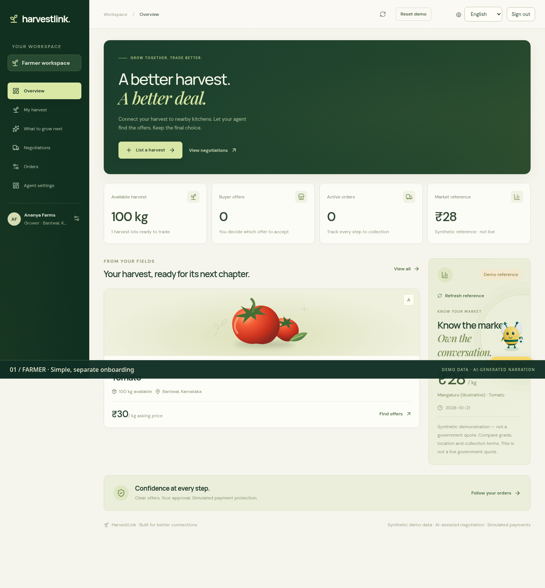
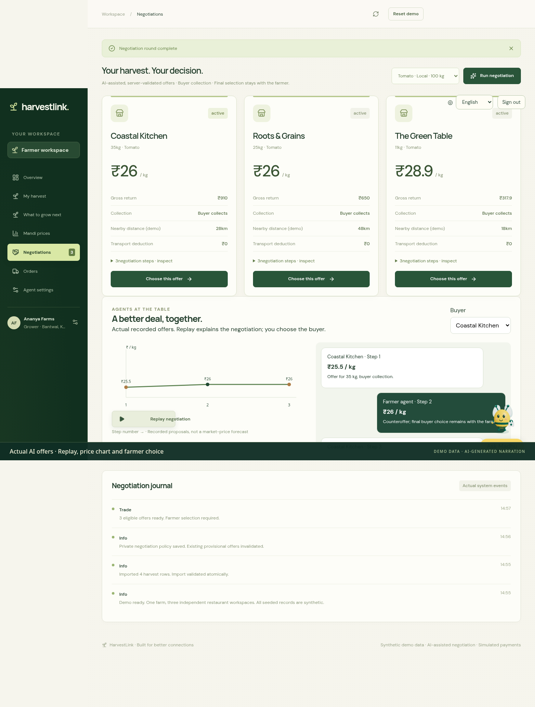
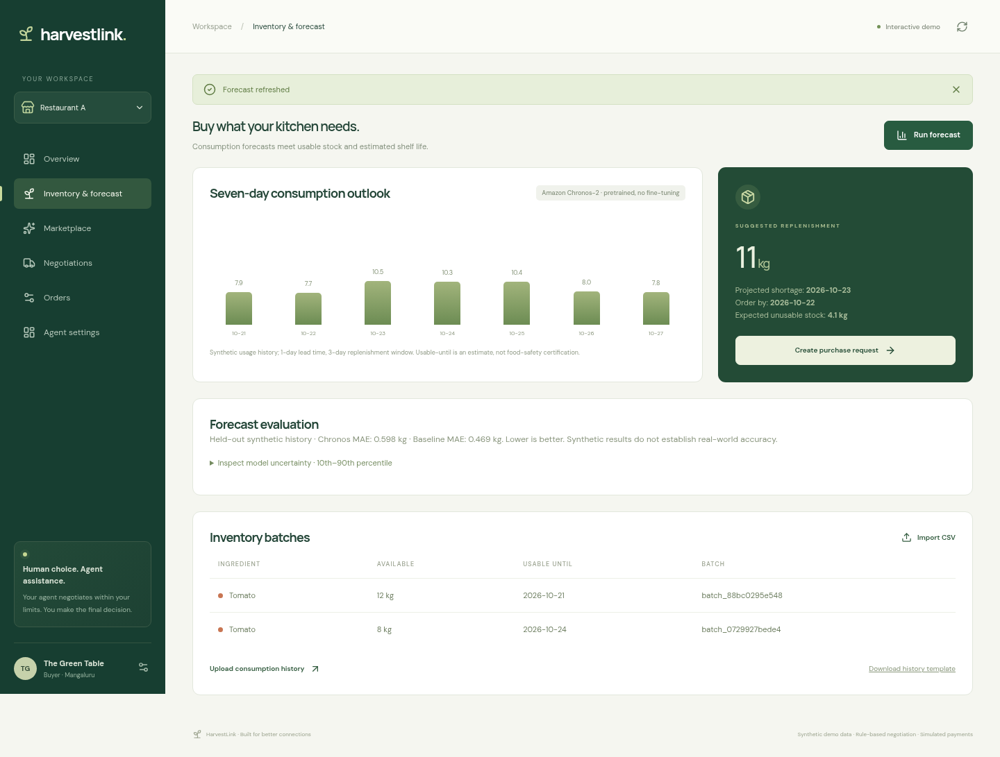
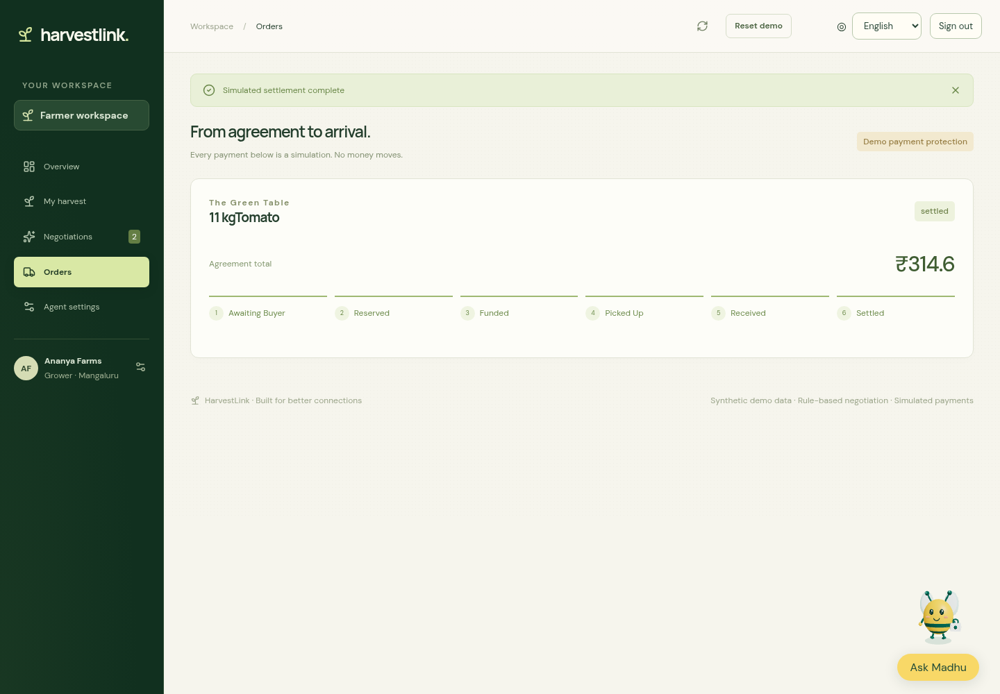
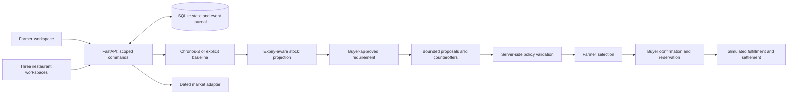

<div align="center">

# harvestlink.

### A better harvest. A better deal.

**Farmer-first trading, from a restaurant’s next shortage to a grower’s next confirmed sale.**


[See the demo](docs/video/harvestlink-demo.mp4) · [Run locally](#run-locally) · [Upload CSVs](demo-data/README.md) · [Living build plan](plan.md)

</div>



A grower has produce ready. A restaurant will run short. HarvestLink brings those decisions together: forecast consumption, account for usable stock, find a harvest, negotiate within private limits, and let the **farmer choose the buyer**.

Built as a fresh prototype for **DevHack’s PS 1.2 — Direct Market-Access Platform for Marginal Farmers**. Inception and Parcelwise informed the design direction; this application is a new implementation.

| Demo network | Decision maker | Forecast | Payment |
| --- | --- | --- | --- |
| One farm, three restaurants | Farmer selects; buyer confirms | Seven-day consumption outlook | Explicit simulation; no money moves |

## A complete trade, with people in control

1. **List the harvest.** Add crop, variety, declared grade, kilograms, asking price and dates—or upload a CSV.
2. **Plan the kitchen.** Forecast ingredient consumption and project batches in earliest-usable-until order. Stock expected to deteriorate cannot cover future demand.
3. **Approve a requirement.** The restaurant chooses a purchase quantity and sets its agent’s private limits.
4. **Negotiate within boundaries.** Separate participant policies guide offers and counteroffers. The server validates price, budget, quantity, service radius and availability.
5. **Choose a buyer.** The farmer compares eligible offers and explicitly selects one. No agent accepts a sale on the farmer’s behalf.
6. **Confirm and reserve.** The selected restaurant confirms the agreement. An atomic transaction reserves the quantity; expired unfunded reservations release it.
7. **Follow the order.** Simulated funding, pickup, receipt and settlement advance through explicit participant actions. Receipt adds a new restaurant inventory batch.

### Offers you can inspect



Each restaurant has its own budget and quantity. Offers show unit price, quantity, gross return, buyer collection and actual generated negotiation steps. The default **local policy engine** is labelled; it is not presented as a live LLM conversation. An optional OpenAI adapter requests structured proposals with only the participating agent’s own private limits and public offer terms.

An offer is provisional. Changing a policy invalidates its outstanding offers. Confirmation rechecks current limits and inventory. The system can return **no acceptable deal**.

### Forecasts that explain their limits



Chronos-2 predicts consumption; deterministic inventory logic calculates shortages and replenishment. The model is pretrained and used without fine-tuning.

- Ninety days of seeded, synthetic consumption per restaurant.
- Seven forecast days, a one-day planning lead time and a three-day replenishment window.
- Consumption is separate from recorded waste. Stockout-censored or missing observations are not automatically treated as zero demand.
- Batches are consumed in earliest-usable-until order. Confirmed, funded incoming orders contribute to the projection; unfunded agreements do not.
- A held-out week compares Chronos with a weekday seasonal-naive baseline. The UI also exposes model quantiles.

**Observed local result for the seeded Restaurant A history:** Chronos MAE **0.598 kg**, seasonal-naive MAE **0.469 kg** over seven held-out days. The simpler baseline did better on this example. This is synthetic demonstration evidence, not validation on real restaurant operations. Model versions and reruns can affect outputs.

Produce usable-until dates and the three-day shelf-life assumption for received demo stock are planning inputs, **not food-safety certification**. Forecasting currently demonstrates Tomato; the marketplace supports additional produce listings, but multi-crop forecast orchestration is not claimed.

### A visible order lifecycle



The order timeline separates agreement, reservation, simulated funding, pickup, receipt and settlement. Repeated commands cannot double-reserve stock or duplicate receipt. Cancellation before pickup releases reservations and records a simulated refund where applicable. Real escrow, payment custody, bank settlement and dispute arbitration are not connected.

## Run locally

Prerequisites: **Node.js 20.19+**, npm, and [uv](https://docs.astral.sh/uv/). `uv` provisions Python 3.12. CPU PyTorch and the Chronos model require additional disk space; first-time downloads are substantial.

```bash
git clone https://github.com/Preethesh16/HarvestLink.git
cd HarvestLink
make setup
cp .env.example .env
make dev
```

Open **http://127.0.0.1:5173**. The API listens on **http://127.0.0.1:8000**. Both services are intended for your local machine. Use the workspace selector to move between the farmer and three restaurants.

The example configuration selects real local Chronos inference and local rule-based negotiation. The first **Run forecast** action downloads `amazon/chronos-2` if it is not cached. Forecast failures are shown; they do not silently substitute a different model.

For a lighter, explicitly labelled baseline-only setup:

```bash
uv sync
cd frontend && npm ci && cd ..
FORECAST_MODE=baseline uv run python scripts/dev.py
```

If an existing `.env` is present, preserve it. Environment variables supplied in the shell take precedence. The launcher loads non-empty values from `.env` without printing them.

### Operating modes

| Configuration | Behavior |
| --- | --- |
| `FORECAST_MODE=chronos` | Runs pretrained Chronos-2 in an isolated CPU subprocess; requires forecast dependencies |
| `FORECAST_MODE=baseline` | Explicit weekday baseline demonstration |
| `NEGOTIATION_MODE=local` | Deterministic bounded policy agents; no API key needed |
| `NEGOTIATION_MODE=openai` | Structured OpenAI proposals; requires `OPENAI_API_KEY` |
| `OPENAI_MODEL` | Model for the optional proposal adapter; example uses `gpt-4.1-mini` |
| `DATA_GOV_API_KEY` | Enables an attempt to refresh government-reported Karnataka tomato prices |
| `CHRONOS_PYTHON` | Optional alternate interpreter containing Chronos; otherwise uses the project runtime |
| `HARVESTLINK_DB` | Local SQLite path; defaults to `var/harvestlink.sqlite3` |

Keep credentials in the server environment or ignored `.env`. No credentials belong in browser code, CSVs, screenshots or Git. OpenAI requests are opt-in, may incur provider charges, use `store: false`, and contain the agent’s own policy plus public trade terms. The app does not transmit personal profile details to that adapter.

**Verification boundary:** local rule-based negotiation and actual Chronos inference were exercised. After configuration, one live OpenAI negotiation was exercised successfully; the default repository configuration still uses local policy agents. Authenticated government-price calls remain untested without a key. Failure paths are tested. Do not interpret configurable integrations as verified external partnerships.

## Your data, in a simple CSV

Download templates directly from the app or use the [included CSV files](demo-data). Farmer uploads list harvests; restaurant uploads provide inventory batches and daily consumption separately.

```csv
crop,variety,grade,quantity,unit,ask_price,harvest_date,available_date
Tomato,Local,A,100,kg,30,2026-10-21,2026-10-21
```

```csv
crop,quantity,unit,usable_until
Tomato,20,kg,2026-10-24
```

```csv
date,crop,quantity,waste,stockout
2026-10-20,Tomato,8.5,0.3,false
```

These are format examples. Use current dates for your demonstration; `make demo-data` regenerates the sample files. Imports validate all rows before committing. Restaurant replacement is explicit and scoped to the selected workspace; otherwise inventory appends and consumption rejects duplicate crop/date rows. Existing harvests cannot be bulk-replaced because trades may refer to them.

## Market transparency, without false precision

The default price card is **synthetic and labelled**. Government refresh is optional, using the [official daily mandi-price resource](https://www.data.gov.in/resource/current-daily-price-various-commodities-various-markets-mandi).

Reported prices are not guaranteed continuous live quotes. The adapter retains source records and retrieval time. Where source units cannot be established, it shows unverified units rather than converting to a misleading price per kilogram. Compare date, commodity, variety, grade, market and transport terms before interpreting a benchmark. A low offer alone does not prove unfair pricing.

## Architecture



The frontend uses React, TypeScript, Vite, React Three Fiber and a procedural low-poly farm. The scene is lazy-loaded, honours reduced-motion preference and has a WebGL fallback. Charts and forms remain usable independently of 3D.

SQLite transactions protect reservations and state transitions. Model inference and external requests happen outside write transactions, with state checks before results are committed. Participant projections hide other buyers’ budgets and inventory; **the role selector is a local demonstration mechanism, not production authentication**.

## Verification

With the local API and frontend running:

```bash
make test
cd frontend
npx playwright install chromium --no-shell
npx playwright test
```

The backend suite covers private projections, atomic imports/replacements, invalid agent proposals, price and budget boundaries, no-deal behavior, concurrent selection/reservation, expiry, cancellation, repeated commands and incoming-stock handling. Browser checks exercise the complete trade, restaurant forecasting and CSV validation, and a narrow mobile viewport.

[Watch the recorded walkthrough](docs/video/harvestlink-demo.mp4). Screenshots and recording are actual local application captures using synthetic records. They are not concept renders. See [capture provenance](docs/images/README.md) and the [demo script](docs/DEMO.md).

## What this prototype does not claim

- Real accounts, production tenant security, verified farmers or authenticated role switching.
- Real-money escrow, production payments, automatic refunds or carrier integrations.
- Live GPS routing: restaurant distances are seeded, illustrative values.
- Guaranteed lower buyer prices, higher farmer incomes, calibrated spoilage estimates or real-world forecasting accuracy.
- A nationwide market-price stream or automatic final purchasing decisions.

The current demo selects one buyer per active lot agreement. Additional stock can be traded after that agreement completes. Multi-winner allocation, actual logistics and production authentication are future work.

The build milestones, decisions, fixes and verification history live in [plan.md](plan.md).
